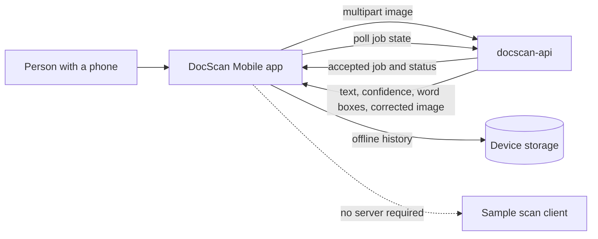
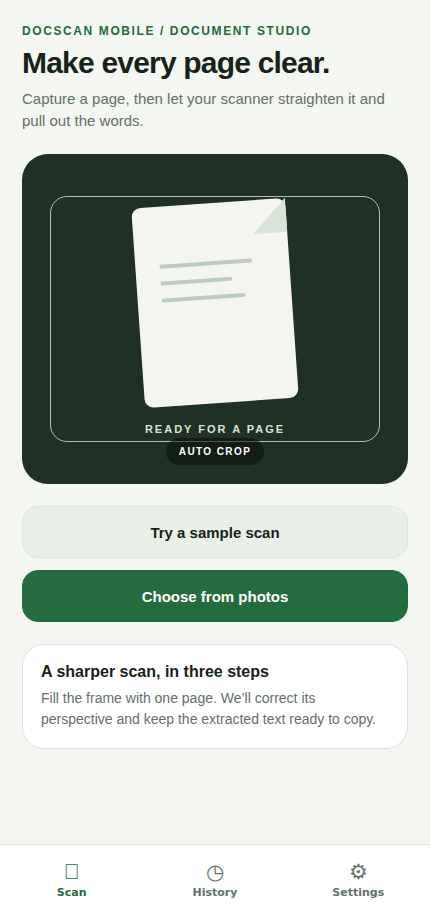
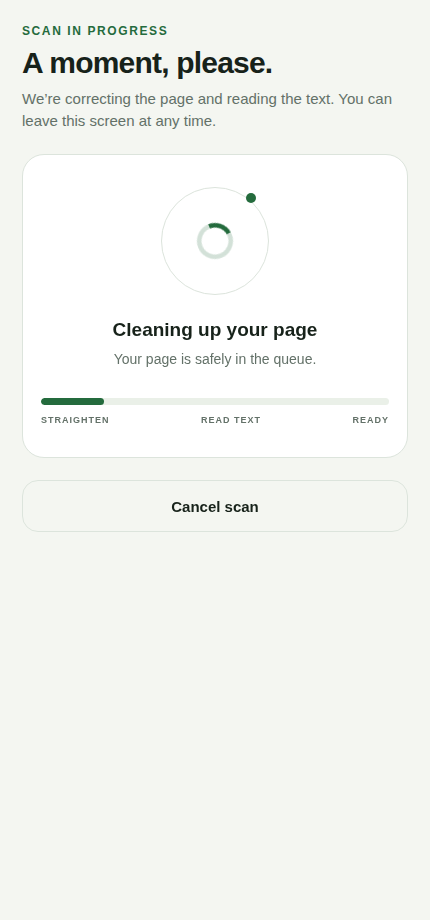
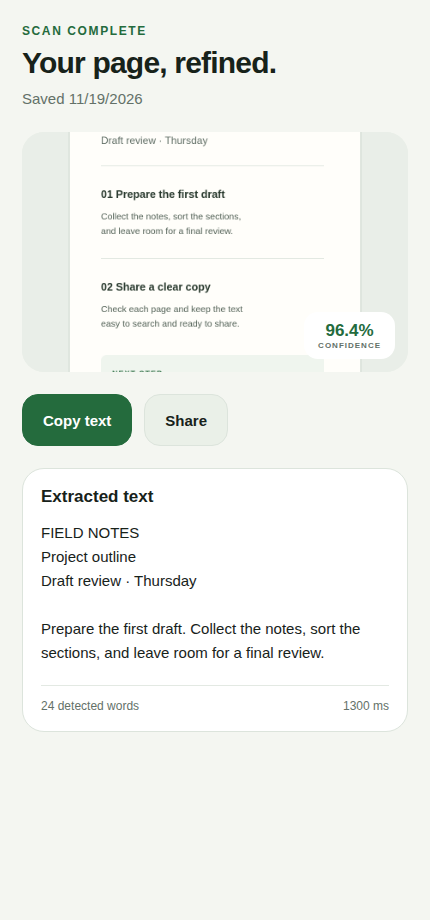
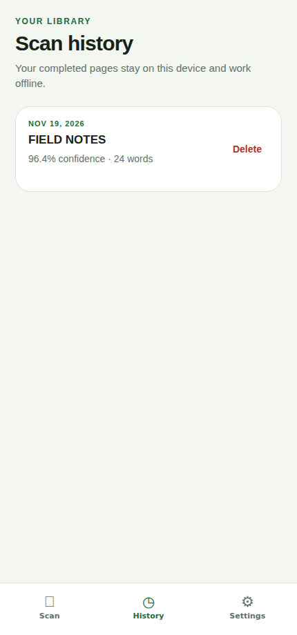
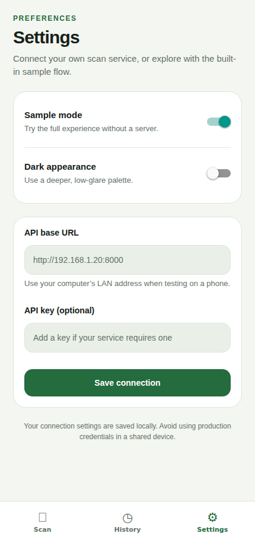

# DocScan Mobile — a document scanner for everyday work

DocScan Mobile turns a quick phone photo into a straightened page and useful, searchable text. It gives people a simple way to digitize notes and forms without typing them out again, while keeping a local history available when they are offline.

Repository: [github.com/JEHH97/docscan-mobile](https://github.com/JEHH97/docscan-mobile)

## Architecture



The app speaks the public versioned contract: multipart `POST /v1/scans`, status `GET /v1/scans/{scan_id}`, corrected image `GET /v1/scans/{scan_id}/image`, and the service health endpoint. An optional `X-API-Key` header is supported. Sample mode uses the same scan-result shape and needs no backend.

## Stack

- Expo SDK 58, Expo Router, React Native, and strict TypeScript.
- Expo Camera and Image Picker for capture and gallery import; Clipboard and Sharing for results.
- TanStack Query for scan mutations and resilient status polling; Zod for runtime API validation.
- AsyncStorage for connection preferences and offline scan history.
- Jest, React Native Testing Library, ESLint, Prettier, and GitHub Actions.

## Technical decisions

- The mobile client models the service’s asynchronous job lifecycle and polls with bounded exponential backoff; polling stops for completed or failed jobs.
- The API adapter validates both successful responses and user-facing failures. Network and transient server errors are retried; unsupported, oversized, and invalid submissions are mapped to clear guidance.
- Sample mode is enabled when no service URL is configured. Its in-memory job advances through queued, processing, and done, then produces fictional OCR output so the whole flow is easy to review.
- Completed results and their image references are stored on-device. History can be reopened without a network request and can be individually removed.
- Camera and gallery access are opt-in. Controls include accessible labels and generous touch targets; the palette supports system light/dark appearance and a manual dark preference.

## Run it

Requirements: Node.js 24 and npm. Install packages, then start the app:

```bash
npm ci
npx expo start
```

Open the QR code in Expo Go, or press `w` in the Expo terminal to run the web experience. Sample mode is on by default if the API URL is empty; open Settings to use a real service.

For a local API, run the service on your development computer and set its base URL in Settings to the computer’s LAN address and port (for example `http://192.168.1.20:8000`). A phone cannot reach the host through its own `localhost`. Add an API key only when your service requires it. `.env.example` contains fake values and no credentials.

## Tests and checks

```bash
npm run check
npx expo export --platform web
```

The check command runs lint, formatting validation, strict type checking, Jest with coverage thresholds, and a repository-content scan. API validation/error mapping, the sample client, polling logic, local history, and screen rendering are covered. CI runs the same check after a push or pull request.

## Screenshots

See [docs/screenshots](docs/screenshots/) for the app captures. A synthetic image at `public/sample-page.png` powers the web sample flow.

| Scan                                      | Processing                                            | Result                                        |
| ----------------------------------------- | ----------------------------------------------------- | --------------------------------------------- |
|  |  |  |

 

## Demo

Live demo: [Add a public demo URL here](https://example.com/demo)

## License

MIT. See [LICENSE](LICENSE).
